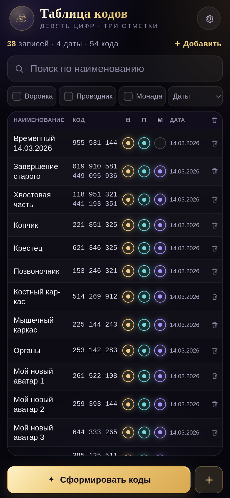
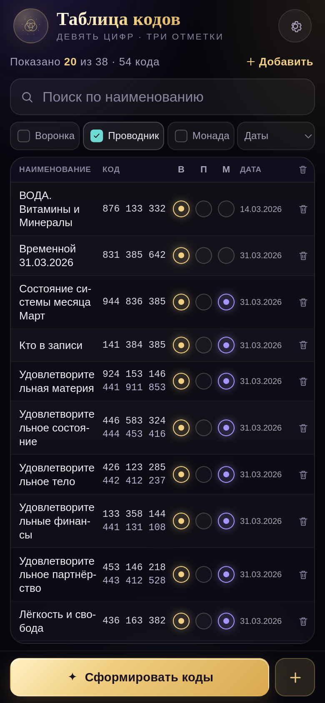
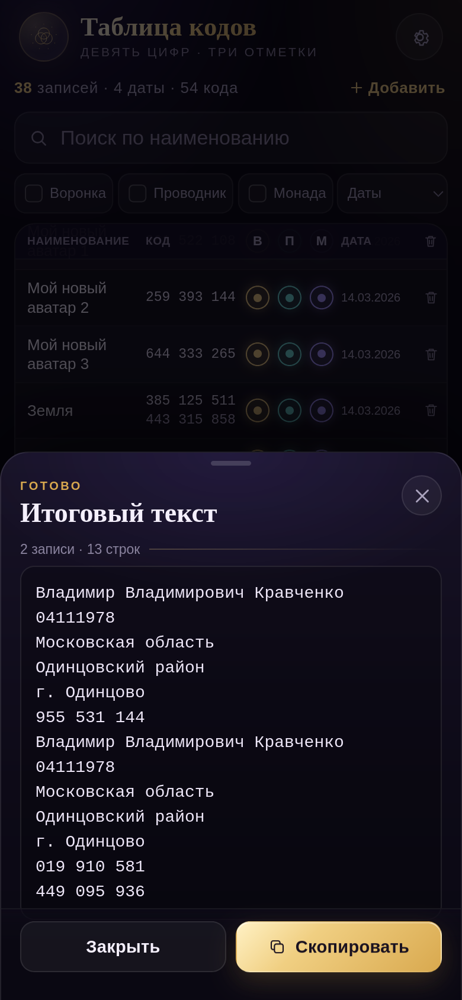

# Таблица кодов

Мобильное приложение для ведения картотеки из девятизначных кодов: компактная таблица, три отметки, даты занятий, фильтры и формирование готового текста для копирования.

Доступно как **PWA** и как **Android APK**. Работает офлайн, данные хранятся только на устройстве.

[](https://vladimirgorodok.github.io/tablica-kodov/)

## Возможности

- **Таблица без горизонтальной прокрутки** на телефоне: наименование переносится по словам, код показывается как `955 531 144`, два кода — двумя строками.
- **Отметки** «Воронка», «Проводник», «Монада» переключаются прямо в строке.
- **Дата занятия** в формате `ДД.ММ.ГГГГ`, с фильтром по датам.
- **Поиск по наименованию** и комбинируемые фильтры: поиск + отметки + дата. Фильтры отметок работают в обратной логике: включённая «Воронка» показывает записи, где эта отметка не стоит. Фильтр дат подписан «Даты», растягивается на свободное место и на телефоне остаётся в одной строке с отметками.
- **Редактирование по нажатию** на строку, добавление и удаление записей.
- **Формирование текста** только по отфильтрованным записям. Для каждого кода:

  ```text
  Владимир Владимирович Кравченко
  04111978
  Ленинградская область
  Мурино
  955 531 144
  ```

  Если в месте больше двух слов, перенос ставится после «область» и «район». Два кода выводятся последовательно. Кнопка «Скопировать» копирует весь текст.
- **Настройки**: ИОФ и дата рождения по умолчанию, список мест, импорт/экспорт JSON, сброс к образцу.
- **PWA**: установка на главный экран, офлайн-кеш, анимированная заставка.
- **APK**: нативная пятисекундная анимированная заставка, адаптивная иконка, системная безопасная зона, импорт/экспорт файлов, буфер обмена.

## Экран приложения

| Таблица | Фильтры | Формирование |
| --- | --- | --- |
|  |  |  |

Больше экранов — в [docs/screenshots](docs/screenshots). Отчёт интерфейсных тестов — [docs/test-report.md](docs/test-report.md).

## Установка

### Android

Скачайте APK из [последнего релиза](https://github.com/vladimirgorodok/tablica-kodov/releases/latest) и откройте на телефоне. Разрешите установку из неизвестного источника, если система попросит.

APK подписан, минимальная версия Android — 7.0 (API 24).

### PWA

Откройте [vladimirgorodok.github.io/tablica-kodov](https://vladimirgorodok.github.io/tablica-kodov/) в браузере телефона и выберите «Установить приложение» или «На главный экран». Для проверки заставки в браузере добавьте `?splash=1`.

## Формат данных

Внутри приложения даты хранятся как `ГГГГ-ММ-ДД`, коды — как девять цифр. Экспорт содержит записи и настройки:

```json
{
  "app": "code-table",
  "version": 1,
  "rows": [
    {
      "id": "row-1",
      "name": "Временный 14.03.2026",
      "codes": ["955531144"],
      "funnel": false,
      "guide": true,
      "monad": false,
      "date": "2026-03-14"
    }
  ],
  "settings": {
    "iof": "Владимир Владимирович Кравченко",
    "birthDate": "04111978",
    "places": ["Ленинградская область Мурино"]
  }
}
```

Импорт принимает полный экспорт или простой массив записей. Некорректные коды отбрасываются, даты нормализуются. Перед импортом приложение предупреждает о замене текущих данных.

## Разработка

```
web/                  PWA: HTML, CSS, логика, данные, service worker
android/              WebView-обёртка, ресурсы, нативный splash
scripts/build-apk.sh  сборка APK без Gradle: aapt → javac → d8 → zipalign → apksigner
tests/run-tests.mjs   27 модульных тестов чистой логики
tests/ui-tests.mjs    61 интерфейсных проверок в Firefox/Playwright
docs/                 скриншоты, отчёт, обложка
dist/                 собранный APK
```

### Тесты

```bash
cd tests
node run-tests.mjs
```

Интерфейсные тесты требуют Playwright и Firefox:

```bash
cd tests
npm install
PLAYWRIGHT_BROWSERS_PATH=../../_tools/pw-browsers \
PLAYWRIGHT_SKIP_VALIDATE_HOST_REQUIREMENTS=1 \
node ui-tests.mjs
```

### Сборка APK

Нужны Android SDK (platform 34, build-tools 34.0.0), JDK 17+, `aapt`, `d8`, `zipalign`, `apksigner`.

```bash
cp android/keystore.example.properties android/keystore.properties
# задайте пароль в android/keystore.properties
ANDROID_HOME=/path/to/android-sdk scripts/build-apk.sh
```

Результат: `dist/tablica-kodov-v1.1.2.apk`. Скрипт копирует `web/` в assets, собирает ресурсы, dex, выравнивает и подписывает APK. При первом запуске создаётся `android/release.keystore`. Ключ подписи и `android/keystore.properties` не входят в репозиторий — храните их отдельно, иначе обновления APK получат другую подпись.

Сборка через Gradle не обязательна. Ручной пайплайн выбран потому, что `aapt2` из SDK не запускается в ARM64-окружении, где готовился проект.

## Приватность

Приложение не отправляет данные в сеть, не использует аналитику и не запрашивает интернет-разрешение в Android. Все записи, настройки и экспорт остаются на устройстве.

## Оформление

Логотип — оригинальная эмблема: три золотых круга и девять точек на тёмно-индиговом фоне. Палитра и анимация заставки общие для PWA и APK.
